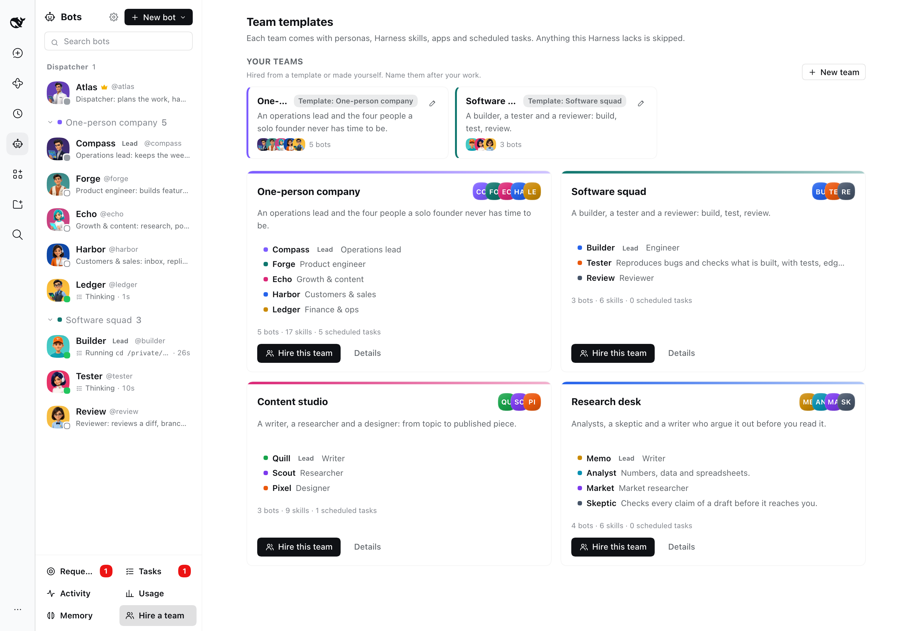
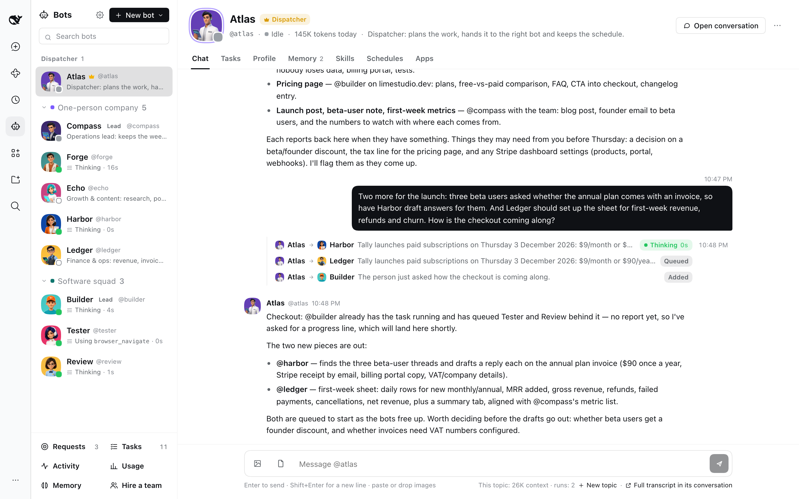
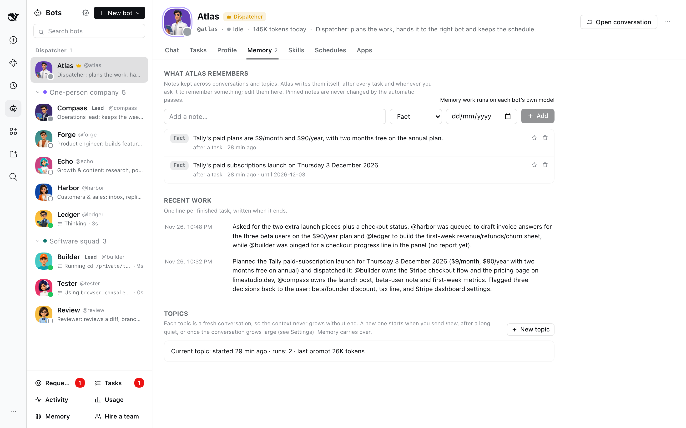
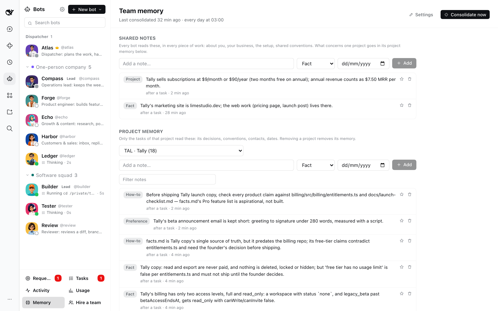
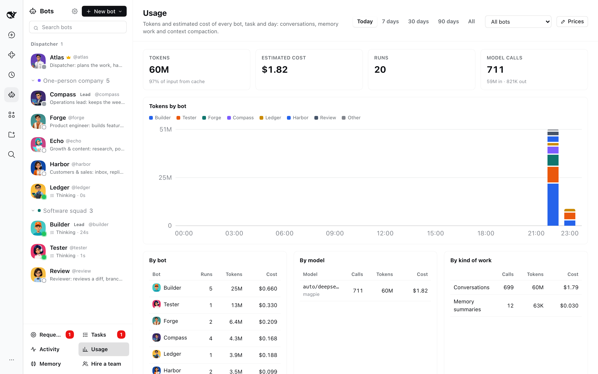

# Bots

English | [简体中文](README.zh-CN.md) · [Changelog](https://github.com/kadaliao/dsh-bots/blob/main/CHANGELOG.md)

Grok-style bots inside DeepSeek Harness: a team of bots that work together. Each bot has its own **avatar,
persona, model, skills, abilities, apps, scheduled tasks and memory**, and its own conversation. Bots **message each
other**, and one of them, the **dispatcher**, splits the work, hands it out, follows up and reports back. Each piece
of work handed out is a **task** that the bot works on in a conversation of its own, so one bot can work on several
at once. The chat with a bot reads like a chat app: the bot on the left, you on the right. To go on about one
message, reply to it: your reply quotes it, and the bot answers in a **thread**, where it sees that message and what
came before it, and nothing said in the chat since.

It is built for two situations:

- **A one-person company (OPC)**: you run a business alone and need a whole staff — engineering, growth,
  customers, finance — plus an operations lead who keeps the week's plan, and a dispatcher who briefs you every
  morning.
- **Work that is naturally split between roles**: code needs a builder, a tester and a reviewer; content
  needs a researcher, a writer and a designer; research needs a skeptic.



## Hire a whole team in one click

Open the Bots panel (sidebar, or `/bots`), pick a team template and click **Hire this team**:

| Team | Members (lead first) | Scheduled tasks |
| --- | --- | --- |
| **One-person company** | Compass (operations lead), Forge (engineer), Echo (growth), Harbor (customers), Ledger (finance) | Compass: weekday 08:30 inbox sweep, Monday numbers and market pulse. Your dispatcher: weekday 09:00 morning brief, Friday 17:30 weekly review |
| **Software squad** | Builder, Tester, Review | — |
| **Content studio** | Quill (editor), Scout (research), Pixel (design) | Your dispatcher: Monday topic planning |
| **Research desk** | Memo (writer), Analyst, Market, Skeptic | — |

There is one dispatcher, the front desk, and it hands out the work of every team you hire. Hire a second team and it
joins the same dispatcher; its bots are listed under their team, so the dispatcher sees who belongs together. With many
teams, click a team's name in the list to fold it to one line (its faces, who is at work, its questions); this browser
remembers it, and the bot you have open stays in sight.

Every team has a **lead**, listed first: the bot that owns the team's result and brings in the others.
Builder leads the software squad (it plans a goal as small changes, checks the plan with you, and has Tester and
Review check each change), Quill the content studio (Scout researches, Pixel draws), Memo the research desk (Analyst
and Market dig, Skeptic checks the draft). The dispatcher hands such a team's work to its lead, never past it, unless
you name a member yourself ("ask @tester to reproduce it"); the lead's teammates report back to the lead, and the lead
answers you once. In the one-person company, whose four roles (product, growth, customers, money) are peers, Compass
leads: its own work is the week's plan (`plan.md`) and the follow-through, it hands each part to the role that fits, and
it runs the team's routines. You can still message any bot directly, a lead or a member. Change who leads
on a bot's **Profile** (**Leads …**), or ask the dispatcher to; a team has one lead at most.

The dispatcher is an ordinary bot: rename it, give it another avatar or persona on its **Profile**, or make another
bot the dispatcher from its own Profile. It leads no team.

A bot you make yourself joins a team you hired with **Team** in **New bot**, or later on its **Profile** (or ask the
dispatcher: `bot_create` and `bot_update` take `team`). In a team with a lead, the dispatcher hands its work to the
lead, which brings the new bot in. A bot moved to another team, or out of one, no longer leads; the dispatcher
belongs to no team.

**Your own teams.** A team doesn't have to be a template. **New bot → New team** makes one with your name, a
description and a colour, the bots in it and its lead (say "Amazon US" with an operator, a sourcer and a supply-chain
bot); it shows in the list under its name, before it has any bots, and the bots read the roster under that name and
description. A hired template team can be renamed, described and recoloured the same way (the pencil on its header in
the list, or **Your teams** on the Teams page); clear a field to get the template's back. Your own teams can be deleted
there: their bots stay, in no team. Leads work the same in your teams as in hired ones.

Hiring:

- creates the bots with bilingual personas, in your UI language;
- gives each member **the skills already installed in your Harness** that fit its role (deep-research,
  last30days, xlsx, high-signal-review, …), skipping and reporting any you don't have;
- imports role skills from [anthropics/skills](https://github.com/anthropics/skills) (webapp-testing,
  frontend-design, brand-guidelines, …) with their scripts;
- adds the apps the role needs (GitHub, Stripe, HubSpot, …), whose keys you fill in later;
- gives the lead the team's own routines (the one-person company's inbox sweep, numbers and market pulse), and your
  dispatcher the ones that reach across teams (the morning brief, the weekly review, the studio's topic planning; one
  it already has by that name is not added twice), and makes a dispatcher, Atlas, when you have none;
- offers to send the dispatcher a kickoff message, so the team starts working right away.



## An example (one-person company)

> **You → Atlas**: We release the new version next week. Organise it.
>
> **Atlas → Compass**: The founder releases the new version next week; plan it with the team.
>
> **Compass → Forge**: Fix the three P1 bugs before release, review your own diff, merge by Wednesday.
>
> **Compass → Echo**: Draft the launch post and three social posts in the founder's voice, by Thursday.
>
> **Compass → Ledger**: For a week after release, check new subscriptions and refunds daily; flag anything odd.
>
> **Forge → Compass**: The three bugs are fixed, tests pass, PR merged.
>
> **Compass → You**: This week: bugs cleared; launch draft for your review tomorrow. Decision needed: do we raise the price?

Bots answer in the language you write in, so the same team works in Chinese and English
([中文示例](README.zh-CN.md#一段示例一人公司)).

Atlas, the dispatcher, hands the one-person company's work to its lead, Compass, which puts the week's plan in
`plan.md` and splits it. Each message from Compass to a teammate opens a task, the three tasks run at the same time,
Forge's message is the report on its task, and Compass answers you once.

## The chat: reply to a message to open a thread

The chat with a bot reads like a chat app such as Feishu: the bot's messages on the left, yours on the right, in the
order they were said. Send as many messages as you like, whenever you like. To go on about one message, reply to it,
the way a chat app quotes a reply: the reply shows at the end of the chat with that message quoted on top, and the
bot answers in that message's **thread**.

<!-- screenshot: a quoted reply in the chat -->

- **What you send shows at once**, marked **Queued** until the bot takes it.
- **Send images.** Click the image button, paste a screenshot, or drop images on the box (PNG, JPEG, WebP or GIF, up
  to ten a message; images alone are a message too). The bot sees them, when its model reads images, and the chat
  shows them; click one to see it large. Work handed on takes them along: a task the dispatcher opens from your
  message carries its images, and so do a lead's sub-tasks. The thread box and a task's message box take images too.
- **Point at any file of your computer.** Click the file button beside the image button and search by file name or
  path (hidden files, `node_modules` and links are not listed); pick up to ten files, which show above the box until
  you send (**×** removes one). The search starts in the folder the conversation works in (on a task's page the
  task's: its project's folder, when it has one), and a bot is not tied to that folder: paste or type a full path
  (`/…` or `~/…`) to look in the folder it names (`~/docs/plan` lists the files of `~/docs` with `plan` in their
  path; the full path of a file gives that file, a hidden one too), or click **Another folder…** to choose a folder in
  Harness's folder dialog and search there. The bot gets each file's full path and reads it with its own file tools
  and permissions, so nothing is uploaded or copied. Work handed on keeps the reference: a teammate working in another
  folder is pointed at the same file, not at a file of the same name in its own folder. A file that was moved or
  deleted before you send is refused, saying so. Files cannot be dropped in: a browser does not tell the page where a
  dropped file is, so only images are taken that way.
- **Reply to any message.** Hover over a message and click **Reply**: it is quoted above the box (**×** or Esc drops
  it), and what you send answers it. The bot answers in a conversation of its own, **forked from its conversation at
  that message**: it sees that message and everything before it, and nothing the main chat said after it. So when
  you come back to an older message a few turns later, the bot answers about that message instead of taking it as a
  reply to the last one. When the message you reply to is your own, the answer the bot gave it then is part of what
  the thread sees.
- **Replies show in the chat, quoted.** Your reply quotes the message it answers; the bot's answer quotes your reply,
  unless it is right under it. Click a quote to see the whole thread on its own beside the chat (over it on a
  narrow screen), where you can go on too. A message with a thread has a small **N replies** link under it, with
  **Replying…** while the bot answers there; the chat also shows the bot at work at its end.
- **The main chat hears what was said in threads.** Since you read the replies in the chat, your next message
  there comes to the bot with a short note of what was said in its threads since (who said what, under which
  message), so it doesn't lose the thread of the conversation. A thread doesn't hear what the main chat said after
  its message.
- **Reply** to a message of a thread to go on in that thread (it quotes that message); threads don't nest. A thread
  has no new topic: `/new` works in the main chat only.
- **Replying to a task's message talks to that task.** Reply to a result or a question from the bot doing a task and
  what you write goes straight to that task; the dispatcher only gets a note, which doesn't wake it, and the task's
  later reports show in that thread. A task that is done but whose conversation isn't archived yet takes it and goes on.
- **The dispatcher answers every message within a step or two**, because it doesn't do the work in its own
  conversation: it hands it to the teammate that fits (the closest one when none fits exactly), never to itself, and
  is free again at once. Two requests sent back to back run side by side, and neither is dropped for the other; a message that
  continues something already under way is added to that task. In a thread it still only routes: a task it hands out
  there reports back into the thread, and what you write later in the thread comes to it first, and it decides which
  task it is for.
- **The bot doing the work answers you itself**, where the request came from (the main chat or a thread), with the
  whole result. Only when the dispatcher splits one request between several bots and has to put the results together
  does it ask for their reports back and answer you itself.
- A thread quiet for a day leaves the Harness sidebar; a new reply brings it back, and the thread goes on where it was.

## The board: every request as a card, filed under projects

A **task** is a bot's view: one piece of work it took on. A **request** is yours: one thing you want. A request often
takes several tasks (the dispatcher splits research between teammates, then hands the results to one who writes them
up), and several messages (you ask, then add "include the UK in the Europe one", then ask how it is going). The
**Requests** board shows each request as a card.

- **The dispatcher restates it.** When it hands out the work, it names the request in one line, in your language,
  saying what you get rather than who does it ("Q3 competitor pricing table (North America + Europe)", not "@scout
  researches North American pricing"). Tasks for the same request count toward it, and what you add later joins it.
  When the dispatcher did not restate one, the title is your own words, and the page says so.
- **Its column comes from its tasks**: **To do** (filed for later, nobody took it yet), **In progress** (with how many
  tasks are done and the latest word), **Waiting for you** (a task asks you something or cannot go on, or the work did not get done)
  and **Done**. Dropped cards fold away below. A follow-up reopens the task, and the card is in progress again. You
  don't move cards between columns by hand, except for two moves: drag a card from **To do** to **In progress** to
  start it, or onto **Done** to mark it done (its tasks still under way are closed, after you confirm).
- **File a card yourself**: **New card** takes a title, a description, a project and who takes it. Given to the
  dispatcher (the default), the card arrives in its chat as your message, marked as the card, and the tasks it opens
  for it count toward the card. Given to one teammate, it goes straight to that bot as a task, opened on the
  dispatcher's behalf: the card shows in the dispatcher's chat with the bot's answers under it, a reply to it goes to
  the task, and the dispatcher is told without being woken. **Add to To do** keeps it for later; **Start** on the
  card's page (or a drag) hands it out then.
- **Projects** group cards and number them: a card filed under project `OPC` is `OPC-1`, `OPC-2`… (numbers are not
  reused). A project has a **folder** and a **brief**. Its tasks work in the folder, which Harness adds as a workspace
  (the same one when the folder is a workspace already); every task of the project reads the brief, and the project's
  own memory ([Memory](#memory)). Without a folder its tasks work in the Bots workspace. **Choose folder…** opens the
  folder dialog of Harness (the desktop app's); you can also type the path. A project's **GitHub repository** is
  `owner/repo`, or the repository's address, on github.com or a GitHub Enterprise server. The dispatcher reads the list of projects and files a new request under one
  when it clearly fits (`project` on `bot_send_message`); a sub-task works on its parent's project. Manage projects
  with **Projects** on the board; filter the board by project with the chips on top. Removing a project keeps its
  cards under no project. Its active tasks continue in their current folders. Queued tasks start in the same folder as
  other tasks without a project. Moving a card to another project affects tasks opened after the move.
- **Name a card in a message**: `OPC-12 add the UK too`, in the panel or a chat app. A message to the dispatcher
  that starts with a card's reference goes straight to that card's task when it has one (as a reply to the task's
  message does), and its answers come back where you wrote; the dispatcher gets a note without being woken. If the
  task reports done before it reads your message, it stays open and answers that too; only then is the card done. A card
  named anywhere else in a message (or one with several tasks) goes to the dispatcher, which reads what each named
  card is, how far it got and its open tasks, and can start one in To do you name.
- **A card can wait for others**: on its page (**Starts after**), in **New card**, or by asking the dispatcher ("do
  OPC-12 after OPC-11"). It stays in To do and starts by itself once they are all done, with whoever you chose (the
  dispatcher, or one teammate), and reads what they delivered. If one of them is dropped or not done, it does not
  start by itself, and the board says so.
- Open a card for its description, your own words (to check the restatement), the question waiting for you
  (**Answer** opens its task), what was delivered and the tasks behind it; **Rename** it, edit its description, move it
  to another project (it gets a number there), **Start** it, **Mark done**, or **Drop it** (its unfinished tasks
  stop). A task's page links back to its card, and so does the card's message in the chat.
- When you say "forget that one", the dispatcher drops the request; when two turn out to be one, it merges them; when
  it answered a card itself, without a task, it marks it done.
- Only what you ask for is a request: work teammates ask each other for, and work a schedule starts, is not.

## Tasks: delegated work in conversations of their own

When a bot hands work to a teammate, the work becomes a **task**. The teammate works on each task in a conversation
of its own, so one bot can take on several tasks at once without mixing them up, and its own conversation stays free
for you. You don't open tasks yourself: you ask the dispatcher (or any bot), and it opens them.

<!-- screenshot: tasks view -->

- **Reports**: the bot doing a task reports with a status: **done** with the result, **question** when it needs an
  answer, **blocked** when it cannot go on, or **progress**, which is kept on the task without interrupting anyone.
  Done, question and blocked go to you as they are, where the request came from (the main chat, a thread or a chat
  app; after you reply to one of them in the panel, in that thread), and the bot that asked
  gets a note that doesn't wake it. When the bot that asked wants the reports back (to put several results together),
  they reach it at once instead and it passes them on; so do a sub-task's reports, and those of a task that came from
  no chat (a scheduled run). A report from a task that has already ended, or from a sub-task whose task has ended, is
  only kept on the task. Anything else the working bot writes stays in the task's conversation.
- **Sub-tasks**: a bot working on a task can ask a teammate for help; that opens a sub-task, whose report comes back
  to the task that asked for it.
- **How many at once**: 4 tasks are worked on at the same time; more wait in line and start as others finish. A
  person's message to a task that has already started (a follow-up, an answer) may use one place more, so new work
  cannot hold it up; a bot's message to it, the dispatcher's too, waits for a free place, and the task shows as
  **Queued** until then. A task that waits for an answer, is stuck or has failed gives its place back once its
  conversation is idle.
- **Stages**: **Working**, **Queued**, **Needs your answer** (it asked a question), **Stuck** (see the watchdog
  below), **Failed** (an error, or a blocked report nobody has answered yet), **Done** and **Stopped**.
- **Tasks** in the sidebar groups them into **Needs you** (needs your answer, stuck or failed), **In progress**
  (working or queued) and **Recently done** (done or stopped). A task's page shows the bot doing it, who asked, where
  the request came from, what was asked, the reports, related tasks and the task's usage, with **Open conversation**,
  **Retry**, **Mark done**, **Stop** and a box for a message to the task (to answer its question, for instance);
  **Mark done** and **Stop** both end the task and stop its bot's work on it at once. Each bot's **Tasks** tab lists
  what it is working on.
- **What bots say to each other stays out of your way**: in a bot's chat, hand-offs, reports and messages between
  bots run together as one quiet group under your conversation with it; those about a task that came from a thread
  show in that thread. **Settings → Chat → Messages between bots**
  sets how much of them shows, the same on every device: **One line** (the default: who hands what to whom, its
  stage and time; a click opens the task), **Short** (and the first two lines of the message) or **Full** (the whole
  message, with the task's card). The bot's replies to you read like the main conversation, without a box.
- **Live status**: while a bot works, its chat says what it is doing right now and for how long ("Running
  `npm test` · 42s", "Thinking · 8s", then the step and the time since it started), and so do the bot's line in
  the list, its tasks in **Tasks** and on the task's page, and a hand-off whose task is running ("Searching for
  “indoor venues” · 12s"). It moves on its own: the panel checks every second or two while something runs. Only the
  tool and a short, clipped summary of what it works on show (a command's first line, a file's name, the words
  searched for), with keys and tokens taken out; never what a tool returned.
- **Removing a bot** stops the tasks it was doing, which are archived, and the tasks it asked for, which stay in
  **Tasks**, stopped, where you can still retry one.
- **Settings → Tasks**: how many tasks are worked on at once (4), the minutes before a quiet task counts as stuck
  (20), and the hours before a finished task's conversation is archived (24).

### The dispatcher as a router

The dispatcher understands the request, hands the work out and keeps track of it. It does not run commands, write or
edit files, search the web, use sub-agents and workflows, draw images, make Office files or put question cards to you
(a card holds every message after it until you answer); it can still read files and use its skills. Work that needs
any of those goes to a teammate, never to itself, while
its own conversation stays free for you. When you say "ask me which tone before you write", it hands the work out with
that request and the teammate asks you in its task; when it must know something itself before it can hand a request
out, it asks in one line of its reply, and your next message is the answer.

To let it do a small job itself (a quick web search, say), turn that ability on in its **Abilities** section, which
marks what dispatching turns off: switch a whole ability back on, or use **Turn back on** for the part of one that is
off (writing and editing under Files). Even then it may not `sleep`, a command must finish within 30 seconds or run in
the background, and with question cards back on it takes no new message until a card is answered.

It never waits for a teammate: it ends its turn and is woken when something needs it, so a new request is not stuck
behind work in progress, and messages that arrive while it is busy are taken together at its next step, and each one
gets its answer. Since it only routes, a light, fast model is enough for it; its **Model** section says so, and Bots
does not change the model for you. Every bot that hands work to a teammate opens a task, not only the dispatcher; but
nobody opens one for the dispatcher: a teammate's message to it goes into its own conversation, and it tells you what
you should know and hands out what is work.

It routes once the team has at least one bot besides the dispatcher; a dispatcher on its own does the work itself.

### Chats and threads

A task remembers the chat it was asked from: a private chat, a Slack or Discord thread, a Feishu topic or reply chain,
a Telegram topic, or the panel.

- **Answers go back where the request came from.** The bot doing a task answers in that task's chat itself, signed
  with its name (`【Forge】`) when the chat app belongs to another bot, so two requests from two chats are answered each
  in its own chat. The dispatcher hears of it with a note that wakes nothing, and leaves that task out of what it says
  in other chats. When one turn of the dispatcher involves more than one chat (the panel and a chat app, say; news of
  a task that came from no chat counts as the panel), it answers each with `bot_reply`, and a task it opens there has
  to say which one it is for (`panel` for the panel). Plain text left over from such a turn stays in the panel, marked
  **Not sent** while a chat still waits for its answer. Once each chat has one it is not shown, unless the panel
  itself was part of the turn: then it is the panel's answer.
- **A follow-up in a thread goes straight to the task.** In a Slack or Discord thread, a Feishu topic or reply chain,
  or a Telegram topic, what you write later in the same thread goes to the tasks started there; the dispatcher only
  gets a note, which does not wake it. Until its conversation is archived, a done task also takes such a message and
  goes on; a stopped task does not. In Slack, Discord and Feishu groups the bot answers under your message, so each
  request there starts a thread of its own.
- **Otherwise a thread gets a conversation of its own, as in the panel.** In a thread with no live task, its first
  message (the one that @mentions the bot in a group, say) goes to the bot's own conversation; once the bot has
  answered there, what you write later in the same thread goes to a conversation forked from the bot's at that
  exchange: it doesn't see what the bot talked about elsewhere since, and nothing said in the thread goes back.
  Replying to one of the bot's own chat messages (a Feishu or Discord reply, a Slack thread) works the same way,
  forked at that message.
  In Telegram only forum topics are threads; a reply in a private chat is not.
- **A follow-up in a private chat goes to the dispatcher.** A private chat (and a group without threads) is one long
  conversation where new requests arrive too, so a message sent there (not a reply) goes to the dispatcher, unless one task asked a
  question there and is still waiting for the answer: then that task takes it. With two or more waiting, it goes to
  the dispatcher, which works out which one it answers.
- A message that starts with `@handle` still goes to that bot's own conversation.
- **A task keeps the message it came from.** The dispatcher hands work out in its own words, so a task opened from a
  chat message also keeps your own words, the chat context read with them (Feishu: the message you reply to, the
  topic or reply chain, chat history you forwarded; see [Feishu / Lark](#feishu--lark)) and the chat's ids. The bot
  doing it reads them under "Where it came from" in its first message, a lead's sub-tasks get them too, and
  `bot_recall` reads them as `ticket/<id>/source`.

### The watchdog

Every 5 minutes Bots checks the tasks in progress by fixed rules; no model judges anything:

- A task whose conversation is idle, with nothing running in the background (commands, sub-agents, sub-tasks), and
  that has had no news for 20 minutes is asked once for a status report. With still no report 20 minutes later, it is
  **Stuck**, and the bot that asked is told.
- After a step fails with a temporary error (HTTP 408, 429 or 5xx, a dropped or refused connection), the task is told
  to continue 15 seconds later, then 30, then 60. A fourth such failure in a row, or any other error, and it has
  **Failed**; the bot that asked is told.
- When every task a bot asked for the reports of has settled (done, failed, stopped or stuck) and that bot has said
  nothing since (an answer marked **Not sent** doesn't count), it gets one reminder to tell whoever asked. Tasks that
  answered the person themselves need no reminder. A task that asked for
  sub-tasks and has ended since gets none.
- After Harness restarts, a task that was in the middle of its work gets a note: check what was already done (files,
  commands, messages sent), don't repeat it, then go on. A task whose conversation is gone starts again from its
  assignment with the same note, and one whose assignment never reached its conversation gets it again. Queued tasks
  start, and messages waiting for a place are handed over, as places free up; no message is handed over twice.

### When a bot asks you a question

A bot can stop and ask you a multiple-choice question (Harness's `ask_user_question`). The question shows as a card
above the message box, in the bot's Chat and on the task's page, and the bot or task is marked as needing you. Pick an
option or type your own answer; answering in the Harness conversation works too, and whichever answer comes first
counts. If the work came from a chat app, the bot also posts there that it is waiting for your answer in DeepSeek
Harness. The answer itself is given in Harness, not in the chat. Plan reviews are answered in the conversation; the
card links to it. A waiting question does not survive a restart of Harness.

### When a tool waits for your approval

A tool in a bot's conversation or task can wait for you to allow it, for example a file write outside the workspace or
a command outside the sandbox. The approval shows as a card above the message box, in the bot's Chat and on the task's
page, with what the tool wants to do, **Allow once** and **Reject**; deciding in the Harness conversation works too,
and the first decision counts. The task is marked **Needs your approval** in the task list and in the chat line of the
bot that handed it out, and the watchdog leaves it alone while it waits. When the bot that asked for the task checks on
it or adds to it, it is told that the task waits for your approval, so it sends you there instead of messaging the task
again. If the work came from a chat app, the bot posts there once that it waits for your approval in DeepSeek Harness;
a reply in the chat does not decide it.

## Built on what Harness already does

A bot works in ordinary Harness conversations, so everything Harness can do, a bot can do:

- **Abilities**: web search, files, running commands and code, Office documents, image generation,
  sub-agents and workflows, handing over files… switched per bot on its Profile tab (a reviewer bot
  that cannot run commands, for instance). In a team of more than one bot, the dispatcher has no Harness sub-agents or
  workflows: work in parallel goes to teammates, so the panel shows it as their tasks (even when a skill says to start
  sub-agents). The other bots keep them.
- **Skills**:
  - **Add from Harness**: pick from the skills you already installed (`~/.agents/skills`,
    `~/.dsh/skills`, …); referenced, not copied, so they stay up to date;
  - **Import from GitHub**: browse Anthropic's skills in one click, or paste any `owner/repo/path`; the
    whole skill folder comes along, scripts included;
  - **Add from a folder**: pick a skill folder on this machine (or a folder holding several, e.g.
    `~/.claude/skills`); linked, not copied, so editing the folder is enough;
  - **Add from Magpie**: shown when this machine has a [Magpie](https://usemagpie.ai) skill library
    (`~/.config/magpie/library/skills`, or under `XDG_CONFIG_HOME` for its command line). It lists the library's skills
    and which agents Magpie gives each to. They are linked, not copied, so when Magpie updates or edits a skill, the bot
    uses the new version; install, update and remove them in Magpie. The skill's card says **Magpie**;
  - a skill name is used once per bot: adding one that is already there is skipped, and importing again
    from the same GitHub folder updates it in place;
  - up to 50 skills can be on at once (each one on is in the bot's prompt every turn); a bot keeps up to
    200 in all, so past 50 new ones come in switched off;
  - **Let the bot write it**: describe what you need in a sentence; the bot writes it with skill-creator
    and saves it to itself;
  - writing one by hand is still possible, as the last resort.
- **Apps** add only the outside systems Harness doesn't reach on its own:
  - **Import from your other agents**: MCP servers you already configured in Codex, Claude Code,
    Claude Desktop, Cursor, Windsurf, Gemini CLI or opencode are found automatically; tick them,
    keys included;
  - **the gallery**:

| Category | Apps (🔑 = needs a key) |
| --- | --- |
| Sales & payments | Stripe 🔑, HubSpot CRM 🔑 |
| Team & office | Feishu / Lark 🔑, Telegram 🔑, Slack 🔑 and Discord 🔑 (chat apps, below), GitHub Issues 🔑 ([below](#hand-work-out-from-github-issues)), Feishu / Lark Open Platform 🔑, Notion 🔑, Slack workspace 🔑, Memory |
| Build & ship | GitHub 🔑, Git, Supabase 🔑, Sentry 🔑, Context7 Docs |
| Research & content | Exa, Keenable, Tavily 🔑, Brave 🔑, Firecrawl 🔑 |
| Computer & browser | Open Computer Use (operate macOS apps), Playwright |
| Data | PostgreSQL 🔑, SQLite |
| Maps & local | Amap 🔑, Baidu Maps 🔑 |
| Custom | Any local (stdio) or remote (Streamable HTTP) MCP server |

  Two are featured at the top, each with a one-click install: [Open Computer Use](#open-computer-use) and
  [Images](#images).

- **Schedules** are ordinary Harness scheduled tasks, also on the Automation page. A scheduled task missed while
  Harness was closed runs when it starts again, once (its latest occurrence): that is Harness's rule, and Bots adds
  no runs of its own. A team with many schedules can open several tasks at once after a start, and use many tokens.
- **AI avatars**: with the [Images plugin](#images), draw a bot's avatar from its persona. A bot can do it too:
  ask the dispatcher to give the team new avatars and describe the look, or point it at an image file. A bot's
  drawing runs in the background, so it goes on answering you: a ring turns around the avatar while the picture is
  drawn, the new one shows when it is ready, and the bot hears that it is ready (or why it failed) and tells you. A restart of
  Harness drops a drawing under way.
- **Logos**: each app in the gallery shows its vendor's own logo (the App Store icon where there is an app,
  otherwise the logo from the vendor's site or repository). The logos are their owners' trademarks and
  only identify each service.

## Each bot on its own model

A bot's **Profile → Model** picks the model its conversations run on (its tasks' too), grouped by provider, with the
model's thinking levels when it has them. Besides the models Harness already has, **Model sources** adds:

- **Your own endpoint**: any OpenAI-compatible (Chat Completions or Responses), Anthropic-compatible or
  Gemini base URL, a key and model ids (or **Fetch models** to tick them from the endpoint's list). It
  becomes a Harness provider `bots-<name>`, its key in the Harness credential store, so it also shows up in
  Settings → Models and in every conversation.
- **A login another agent on this computer already has**: the Codex CLI's ChatGPT login
  (`~/.codex/auth.json`) becomes Harness's `openai-codex` provider. OpenAI rotates the login on every
  refresh, so the two copies are kept in sync both ways — whichever side refreshes, the other gets the new
  tokens, and neither signs the other out. Claude Code's login is shown but not offered: Anthropic allows a
  Claude subscription only in Claude Code and claude.ai, so add Claude with an API key instead.


## Topics: conversations that don't grow forever

A bot's own conversation is a **topic**. A new topic is a fresh conversation (the old one is archived, the
bot's scheduled tasks move along); what the bot knows carries over in its memory. A new topic starts:

- when you send `/new` (or `/clear`, `/新话题`) in the panel or from a chat app — text after it goes to the
  new topic — or click **New topic** under the composer;
- by itself before the next request, after **6 hours** of quiet, or once the conversation's prompt reached
  **128K tokens** (Settings; 0 turns either off). A big conversation is never cut while a teammate's
  answer may still be coming.

Harness still compacts a conversation that nears the model's limit; topics keep every call small and cheap
long before that. A task's conversation is not a topic: it ends with its task. A task's report reaches the bot
that asked for it even after that bot started a new topic. Threads are not topics either: a new topic leaves the
threads as they are, and a message from an earlier topic can still be replied to. The old conversation is archived,
and the Bots panel stays where it is (it used to jump to Harness's conversation view).

## Memory

Every bot keeps **notes** that outlast its topics. Two more lists are shared:

- **Shared notes**, read by every bot in every piece of work: about you, your business, the setup, shared
  conventions.
- **Project memory**, one list per project, read only by the tasks of that project: its decisions, conventions,
  contacts and dates. Removing a project removes its memory.

How notes are written and kept:

- **After each piece of work** a short model call writes one line to the bot's **journal** (what was asked,
  what came of it) and adds, corrects or removes notes — preferences, people, decisions, procedures, lessons.
  What every bot should know goes to the shared notes; what concerns the task's project only goes to that project's
  memory. In a bot's own conversation this happens after every **run** (everything the bot does for one request,
  until it is idle again); for a task, once, when the task ends.
- **Notes never record the state of work** (done, delivered, waiting), where a file is, or who is on the team: the
  journal, the board and the roster keep those.
- **A note about something with a date** (an event, a deadline, an offer) has a **last day**. After it, the note is
  no longer read, and the next consolidation removes it. The passes give one to dated notes; you can set or clear it
  in the panel. Pinned notes never run out.
- **The bot itself** saves notes with `memory_save` (scope `self`, `team` or `project`, with `until` for a last day)
  when you tell it to remember something, removes them with `memory_forget`, and looks through notes, the team
  journal, digests and tasks (their titles and reports) with `memory_search`. In a task's conversation it finds,
  besides its own and the shared notes, only its project's notes, the journal lines and tasks of that task, the task
  that asked for it and its sub-tasks, and no digests.
- **Every night** (03:00 by default) memory is **consolidated**: notes past their last day go first; each bot's
  notes are merged, corrected and trimmed with its recent journal, the shared notes and the projects' memory too (a
  shared note about one project moves into that project), and the day's work is written up as the team's **daily
  digest**. **Consolidate now** runs it at once. Notes and digests are written in the
  language you write to the bots in, judged from your recent messages; a note left in another language
  is rewritten in it.
- A bot reads its notes, the shared notes (a task of a project, that project's memory too), its last few journal
  lines and the latest digest when a topic or a task's conversation starts, and again at the next run after you edit memory or the nightly
  consolidation ran. Within a topic the memory part of its prompt stays the same, so the model's prompt
  cache over the conversation keeps working (what it learns in a topic is in that conversation anyway). A
  short exchange — an acknowledgement, a one-line answer to a teammate — gets a journal line without a
  model call.
- The **Memory** tab of a bot and **Team memory** in the sidebar show everything (**Project memory** there, by
  project); add, edit, pin or delete notes, and set a note's last day. Pinned notes are never changed by the automatic passes. Text that looks like a key
  or token is never stored.
- Memory work runs on each bot's own model unless Settings names a cheaper one.





## Usage

**Usage** in the sidebar counts every model call the bots make — their conversations (tasks' included), the
memory work and Harness compacting their context — by bot, model, kind of work, scheduled task, task and day
(or hour, for today), with the change from the period before. **Runs** and **Recent runs** count runs (see
Memory: one request, from you, a chat app, a schedule or another bot, until the bot is idle again); a task
takes one run or more, **By task** adds them up, and a task's own page shows its usage. Costs are
estimates from your own prices or LiteLLM's public price list (**Prices**); a model with no price shows its
tokens only.



## Message your team from Feishu, Telegram, Slack or Discord

Add **Feishu / Lark**, **Telegram**, **Slack** or **Discord** to a bot (normally the dispatcher) in its **Apps** tab, and you can hand out
work from your phone: what you send the chat bot goes to the team as if you typed it in the panel, and
the replies come back to the chat, including the dispatcher's report once its teammates have answered.

> **You, in Telegram**: Get the release organised for next week.
>
> **Atlas**: On it: Forge takes the three P1 bugs, Echo drafts the launch post.
>
> **Atlas** (later): Bugs fixed and merged; the launch draft is ready for your review.

### Telegram

1. In Telegram, open [@BotFather](https://t.me/BotFather), send `/newbot`, pick a name and a username
   ending in `bot`. Make a new bot just for this team.
2. In Bots, open the dispatcher → **Apps** → **Telegram** → paste the token BotFather gave you → **Add**.
   It connects at once and shows **Connected as @yourbot**.
3. Pair yourself: the panel shows a one-time code (it works once, for 10 minutes). Click **Open in
   Telegram** and press **Start**, or send the code to your bot. The bot answers "Paired".
4. Message the bot. Start a message with `@handle` to reach another bot directly (`@forge fix the login bug`).
   In a group, add the bot and @mention it (or reply to it); it ignores the rest of the conversation.

### Discord

1. In the [Developer Portal](https://discord.com/developers/applications): **New Application** → **Bot** →
   **Reset Token** and copy it. On the same page turn on **Message Content Intent** (without it the bot
   cannot read messages, and the panel says so).
2. Add **Discord** to the dispatcher with that token. Once connected, use **Invite the bot to a server**
   (any server you are in, a private one is fine): Discord only lets you DM a bot you share a server with.
3. DM the bot the pairing code, then DM it your requests, or @mention it in a channel.

### Feishu / Lark

Feishu uses its long connection: the Harness connects out to Feishu, so your computer needs no public
address. The same steps work for Lark; the panel finds out which one your app belongs to.

1. Open the developer console at https://open.feishu.cn/app (Lark: https://open.larksuite.com/app) and
   **Create Custom App**.
2. **Add Features** → **Bot**.
3. **Permissions & Scopes** (**Batch import/export scopes** accepts the JSON below):
   - required: `im:message.p2p_msg:readonly`, `im:message.group_at_msg:readonly`, `im:message:send_as_bot`
   - optional: `contact:contact.base:readonly` + `contact:user.base:readonly` (sender names),
     `im:message.reactions:write_only` (a "Typing" reaction while the team works), `im:chat:readonly` (group names),
     `im:message:readonly` (the images you send, and the chat context below: the message you reply to, chat history you forward),
     `im:message.group_msg` (the earlier messages of a topic; a sensitive scope an admin approves)
4. Copy the **App ID** and **App Secret** from **Credentials & Basic Info** into the bot's **Apps** →
   **Feishu / Lark**, and save. The long connection comes up. If the panel asks you to turn on the bot,
   that only means no version is published yet; the connection is already online.
5. With the Harness running, go to **Events & Callbacks** → **Event Configuration**, set the subscription
   mode to **Receive events through persistent connection** and save. The console only accepts this while
   a connection is online.
6. **Add Events** → `im.message.receive_v1`.
7. **Version Management & Release** → create a version whose availability includes the people who will
   use it, and publish (an admin may need to approve).
8. In Feishu, open a chat with the bot (search for the app, or use **Open in Feishu** in the panel) and
   send the pairing code. For a group, add the bot to the group and @ it.

Use an app made for this team only: when several programs connect with the same App ID, Feishu hands each
message to just one of them.

**Images.** Send a picture, or a rich-text message with pictures in it, and the bot sees them as it does images
you attach in the panel: the chat shows them, and the dispatcher hands them on with the work. The channel reads
them from Feishu only once it knows the message is yours (paired) and for the bot, at most ten per message, each
up to 20 MB (PNG, JPEG, WebP or GIF). Where a picture was, the text says `[image]`, so a picture that could not be
read (no `im:message:readonly` permission, too big, another format) still shows the bot that one was there; the
Harness log says why it was left out.

**Chat context.** When your message replies to another one, sits in a topic or reply chain, or is chat
history you forwarded to the bot, the channel reads that from Feishu before the team sees your message:
the message you reply to, the start of the chain or the topic's last ten messages, and up to thirty
forwarded messages (files and images by name). The dispatcher reads them with your message, and the task
it opens keeps your own words and that context, with the chat's ids for a bot that has the Feishu / Lark
Open Platform app, so the bot doing the work knows what "this" means. Those messages are often written by people
you did not pair (colleagues in the group): what they wrote then goes to the bots' model and into `tickets.json`,
as it would if you pasted it in yourself. It is only read when a paired person's message points at it (a reply, a
topic, a forward); the permissions are the switch, so leave `im:message:readonly` off to keep it out, and let the
people in a group with the bot know. Chat history you forward on its own also goes with
the task you open from your next message ("summarize this"), sent within ten minutes. Without the permissions above
the message goes on as before, and the Harness log says which permission to add.

```json
{"scopes":{"tenant":["im:message.p2p_msg:readonly","im:message.group_at_msg:readonly","im:message:send_as_bot","im:message.reactions:write_only","contact:contact.base:readonly","contact:user.base:readonly","im:chat:readonly","im:message:readonly"],"user":[]}}
```

### Slack

Slack uses Socket Mode: the Harness connects out to Slack, so your computer needs no public address.

1. Open https://api.slack.com/apps → **Create New App** → **From a manifest**, pick your workspace, choose
   the JSON tab and paste the manifest below (rename "Bot Team" if you like) → **Next** → **Create**.
2. **Install App** → **Install to Workspace** → **Allow**. Copy the **Bot User OAuth Token** (`xoxb-…`).
3. **Basic Information** → **App-Level Tokens** → **Generate Token and Scopes**: any name, **Add Scope** →
   `connections:write`, **Generate**, and copy the token (`xapp-…`).
4. In Bots, open the bot → **Apps** → add **Slack**, paste both tokens and save. Once it shows
   *Connected*, a pairing code appears.
5. In Slack, open the app (**Open in Slack** next to the code, or Apps → your app → Messages) and send it
   the code.
6. To use it in a channel, invite the app (`/invite @Bot Team`) and @mention it; it answers in the thread.

Use one Slack app per bot, and don't run the same app in another program: Slack hands each message to only
one connection. If you change scopes later, reinstall the app to the workspace and press **Reconnect**.

```json
{
  "display_information": {
    "name": "Bot Team",
    "description": "Message your bot team from Slack: DM the app, or @mention it in a channel.",
    "background_color": "#4a154b"
  },
  "features": {
    "app_home": { "home_tab_enabled": false, "messages_tab_enabled": true, "messages_tab_read_only_enabled": false },
    "bot_user": { "display_name": "Bot Team", "always_online": true }
  },
  "oauth_config": {
    "scopes": { "bot": ["app_mentions:read", "channels:read", "chat:write", "groups:read", "im:history", "users:read"] }
  },
  "settings": {
    "event_subscriptions": { "bot_events": ["app_mention", "message.im"] },
    "org_deploy_enabled": false,
    "socket_mode_enabled": true,
    "token_rotation_enabled": false
  }
}
```

### What else to know

- **Who can talk to it**: only people you paired. Anyone else is ignored; in a private chat they get at
  most one "this bot is private" line a day. Pairing happens only in a private chat, with the current
  code, and a few wrong guesses lock a person out until the next code. You can pair more people (each
  needs a new code) and remove anyone from the panel; the panel also counts ignored messages.
- **Treat a pairing like your own login**: a paired person can ask the bots for anything you could,
  including whatever their abilities and apps allow on this Mac. Pair only yourself or people you trust,
  and turn off risky abilities on the bot that owns the channel if others are paired.
- **Where replies go**: to the chat the request came from, and a task's result to the chat that task was
  asked from (see [Chats and threads](#chats-and-threads)). Write in the panel and the answer stays in the
  panel. Telegram gets plain text (Markdown markers removed); Discord, Slack and Feishu show the Markdown.
  In a Slack channel the answer goes into the thread of your message.
- **Scheduled reports**: a scheduled task of the bot that owns the channel reports to the first paired
  person (switch it off in the panel), so "every weekday at nine Atlas briefs you" lands on your phone.
- **One token, one place**: a chat bot token can be connected on one bot of one Harness at a time. If
  another program uses the same Telegram token, the panel says so.
- The token is stored with the bot like other app keys, never shown back in the panel, and kept out of
  logs and error messages. Harness must be running for the bot to answer; Telegram holds messages for up
  to 24 hours, and a message is never run twice after a restart.

## Hand work out from GitHub issues

Add **GitHub Issues** to your dispatcher (Apps → Team & office) with a fine-grained token limited to the
repositories you name, with Issues: read and write. Put the label (`bots`, unless you set another) on an open issue,
and the team takes it:

- **The issue becomes a card** on the board: its title, its body as the description, a link to it, and, when a
  project has that repository (**GitHub repository** in the project), filed under that project and numbered there.
  The dispatcher gets it in that issue's thread, and hands the work out as for any card.
- **Answers are comments** on the issue, signed `【Forge】` like in a chat app, so everyone who can see the repository
  reads them. A comment on the issue later goes to its task when one is working on it, else to the dispatcher.
- **Only the repository's owner, members and collaborators start work**: an issue counts when one of them wrote it or
  put the label on it (an issue form can add a label for anyone), a comment when one of them wrote it. Everyone else is
  ignored without an answer; the panel counts them. Issues are read by the bots, so this keeps strangers' text out of
  their prompts.
- **No public address**: Harness asks GitHub every minute for labelled issues and new comments (with an ETag, so an
  unchanged answer costs no rate limit). Issues labelled while Harness was closed are caught up when it starts. On its
  first start it looks from then on: label an older issue again to hand it out.
- The token's account is the one that comments; a bot account of its own reads best. Its own comments (and anything
  marked `<!-- dsh-bots -->`) are never read back as messages.
- **GitHub Enterprise**: write the repositories as their addresses (`https://github.example.com/owner/repo`), and make
  the token on that server. The app then talks to the server's API (`/api/v3`, or `api.<name>.ghe.com` on GHE.com). One
  app watches one server; add it once more for another. A project's **GitHub repository** takes the same address.

## How it works

- Each bot has a home conversation in Harness and a separate conversation for each task (`ticket-<id>`).
  Set `bots.config.workdirs` by handle (for example, `workdirs: { forge: /projects/forge }`) to use that folder
  for Forge's new home conversations and tasks received without a project. If the handle has no entry or the path
  is not an existing directory, they use the shared **Bots** workspace (`workdir`, default `~/.dsh/bots/workspace`).
  Project tasks use the project's folder, or the shared workspace if the project has no folder set. Harness archives
  a task's conversation once the task has been over for the hours set in Settings. Each thread is a conversation too, forked with Harness's session fork
  from the bot's conversation at the message replied to and titled "<bot> · <the start of that message>"; it is
  archived after a quiet day and taken out of the archive on the next reply.
- When it runs, the bot's persona and the team roster join its system prompt; its own skills, ability
  limits and apps apply to its conversations only. In a task's conversation the prompt also says which
  task it is, who asked, and how to report, and for a task of a project, the project's brief and folder. The
  dispatcher's prompt lists the projects. Edits apply at once; a new or changed app connects the next
  time the conversation starts.
- `bot_send_message` from a bot's own conversation opens a task and returns at once; from a task's
  conversation it reports to whoever asked (with a status) or opens a sub-task. A message to the dispatcher
  opens no task: it goes into the dispatcher's own conversation (one sent from a task names it, and the
  dispatcher's answer is added to that task). The dispatcher names the request a task serves with `need`
  ([The board](#the-board-every-request-as-a-card-filed-under-projects)). Two bots may exchange at most 16 messages in 10
  minutes (new tasks and messages added to tasks count), so conversations end.
- A bot with nothing to say (after a report, say) answers `NO_REPLY`, which is never shown or sent to a chat app.
  Harness counts an answer with no content as a failed model call (`returned a completed response with no
  content`), so a bot cannot just say nothing; should a model still answer with nothing, its task does not fail
  for it.
- Every conversation gets `bot_list`, `bot_create`, `bot_update`, `bot_delete`, `bot_send_message`,
  `bot_reply`, `bot_recall`, `bot_ticket`, `bot_need` and `bot_schedule` to manage bots and tasks, and `memory_save`,
  `memory_forget` and `memory_search`. `bot_reply` sends an answer to a named chat; `bot_recall` reads a
  task, its reports or its conversation, or a chat thread, a page at a time, so a bot looks things up
  instead of guessing; `bot_ticket` stops, closes or retries a task the bot asked for, or asks it for a
  status report; `bot_need` lets the dispatcher rename, merge, drop, finish or file one of your requests (by its id or its card, `OPC-12`). [API.md](https://github.com/kadaliao/dsh-bots/blob/main/API.md) lists their parameters. A sub-agent started in a bot's or a task's
  conversation uses them as that bot or task; one that cannot be traced back to where it started (that
  conversation is gone) is refused.
- A bot's memory is a section of its system prompt, read when a topic or a task's conversation starts
  (and at the next run after a memory edit in the panel or the nightly consolidation), never in the middle
  of a run. A run ends when the bot's Agent is idle; its transcript (prompts, replies, tool calls, short
  tool results), or for a task the transcript of its runs, is what the memory pass reads. Usage comes
  from the `assistant/message` and `compaction/summary` events of the bots' conversations, plus the
  plugin's own memory calls.
- A chat app is not an MCP server: the Host keeps one connection per chat app (long polling for Telegram,
  the gateway for Discord, Socket Mode for Slack, the long connection for Feishu), starts and stops it as you add, change, switch off or remove the
  app, and hands paired people's messages to the bot as user prompts headed
  `[Telegram · Name] (thread <key>)`, or to the tasks or the own conversation of that thread (see
  [Chats and threads](#chats-and-threads)). The thread key is what `bot_reply` names. The chat context a
  connector reads with a message (Feishu does) follows it as one more block, `[Chat context, read from Feishu with
  this message]`. GitHub Issues polls instead:
  each repository is a chat, each issue a thread, and its cursors are kept in `channels.json`.

## Open Computer Use

[open-computer-use](https://github.com/kadaliao/open-computer-use) lets a bot operate macOS apps through
the accessibility tree. Click **Install now** on its card, then grant **DeepSeek Harness** Accessibility
permission and restart it.

## Images

[Images](https://github.com/kadaliao/dsh-images) (`@kadaliao/dsh-images`) gives the bots a `generate_image`
tool, on your provider's image model: pictures, posters, GIFs, and the bots' AI avatars. It is featured in the
gallery beside Open Computer Use. It is a Harness plugin rather than an MCP server, so one install serves every
bot: click **Install now** on its card and Harness's plugin manager installs it from npm (a card that says
**Turned off** switches it back on instead). Then open the **Images** panel in the sidebar and choose the image
model under **Settings**. Harness may pick a release a little older than the newest when the newest is only
hours old; Images then offers the update itself.

Every bot can draw once it is installed, except a dispatcher that only hands out work. **Abilities** on a bot's
Profile page turns **Image generation** off for that bot, and **Add** on the card turns it back on.

## What it stores and sends

- `~/.dsh/cache/bots/` (`bots.json`, `channels.json` and `tickets.json` are readable by your user only):
  `bots.json` (bots, including keys and chat bot tokens entered for apps),
  `messages.jsonl` (timeline), `channels.json` (paired people per chat app, and the last message handled
  per chat), `tickets.json` (tasks, with what was asked and their reports, the chat threads they came
  from, and the chat message that started each, with the chat context read with it; the newest 500 archived tasks are kept), `avatars/`, `skills/` (skills imported from GitHub),
  `memory/` (notes — each bot's, the shared ones and each project's —, journal, digests), `usage.jsonl` and `tasks.jsonl` (token counts per call and run,
  kept 400 days), `topics.json`, `discussions.json` (threads, where each message sits in its conversation, threads
  you have read), `needs.json` (your requests: the cards on the board, with your words and descriptions) and
  `projects.json` (projects, with their folders and briefs), both readable by your user only, `settings.json`
  (with your own teams' names), `images.json` (which images messages and tasks carry, by id), `price-catalog.json`. If `tickets.json` cannot be read
  (permissions, say), Bots does not start and says why in the Harness log, so the file is never written over;
  a damaged one is kept as `tickets.json.corrupt-<time>` and tasks start empty.
- Images you send are stored by Harness's own attachment store (`~/.dsh/attachments/`), as images pasted into a
  Harness chat are, and go to the bot's model with the message; Harness keeps them, Bots only their ids.
- A file you reference is not copied: the message and the tasks it leads to keep its full path (in the timeline and
  `tickets.json`), and the bot's model sees what the bot reads of it.
- Custom endpoints and a borrowed Codex login are written to Harness's own model settings (`llm-pi-ai`) and
  credential store. With the Codex login in use, tokens Harness refreshes are written back to
  `~/.codex/auth.json`.
- Nothing leaves your machine except through the bots' own conversations (your configured model), the
  memory passes (a run's or a task's transcript and the bot's notes, to the bot's model or the memory model), the
  LiteLLM price list (downloaded from GitHub weekly), the apps you connect, the image model when you generate an avatar, GitHub when you import skills, and the
  Feishu / Lark, Telegram, Slack or Discord API when you connect a chat app (the bots' replies to paired
  people, typing indicators, and the one-line note to strangers; Feishu is also asked for the messages a paired
  person's message replies to, the topic it is in, or the chat history they forwarded to the bot; those may be other
  people's words, unpaired ones too, and they go to the bots' model with the request and are kept with its task,
  and for the images in a paired person's message to the bot), and the GitHub API with GitHub Issues (reading the
  watched repositories' labelled issues and comments, and posting the bots' answers as comments).

## Install

Add the [DSH Plugins](https://github.com/kadaliao/dsh-plugins) index in DeepSeek Harness (**Plugins → Discover → Sources**):

```
https://raw.githubusercontent.com/kadaliao/dsh-plugins/main/marketplace.json
```

then install **Bots**. The Discover tab is part of the experimental **Custom plugin markets**
feature; turn it on under **Plugins → Experimental plugins** if you don't see it.

Without Discover, paste the package name into the plugin manager:

```
@kadaliao/dsh-bots
```

For the latest unreleased code, use the Git spec `git+https://github.com/kadaliao/dsh-bots.git#main` instead.

Refresh the page once after installing. For pictures and AI avatars, install [Images](#images) too: one click
on its card in any bot's **Apps** page.

## Updates

Each time you open the Bots panel, the plugin checks whether a newer version of itself is out; opening
it again within a minute reuses the answer, and nothing checks in the background. The check goes
through Harness's own plugin manager, the same check as the Versions section in **Plugins**, and asks
the npm registry only about this package. A newer version shows as a bar across the top of the panel.
**Update** has Harness install it, after checking that it works with your Harness; if the install
fails, the version you had is put back. While it updates, the panel closes, and it opens again once
the new version is in. **Later** hides the bar for a day, **Skip this version** until the next one.
Copies installed from a folder or from Git are not checked.

What each version changed, and what to do after upgrading, is in the [changelog](https://github.com/kadaliao/dsh-bots/blob/main/CHANGELOG.md).

## Limits

- Web UI only.
- Group chats between bots are not there yet; bots work together through tasks and direct messages.
- In a group chat a bot hears only messages that @mention it (or reply to it); it does not listen to the
  rest of the conversation.
- A thread doesn't see the main chat's later messages because it is a fork, and a fork needs the message's place in
  the conversation's log. For a very old message whose place cannot be found, the thread forks at the latest turn and
  sees what came after (the bot is told so).
- The watchdog goes by time and status only; it does not judge whether a task is heading the right way.
- Costs are estimates. Gateways, subscriptions and discounts bill differently; set your own prices.
- Only the Codex CLI's login can be borrowed so far; other subscriptions sign in from Harness Settings →
  Models where Harness supports them.
- Harness skills a team template names that you don't have are skipped; import them from GitHub or have
  the bot write them later.
